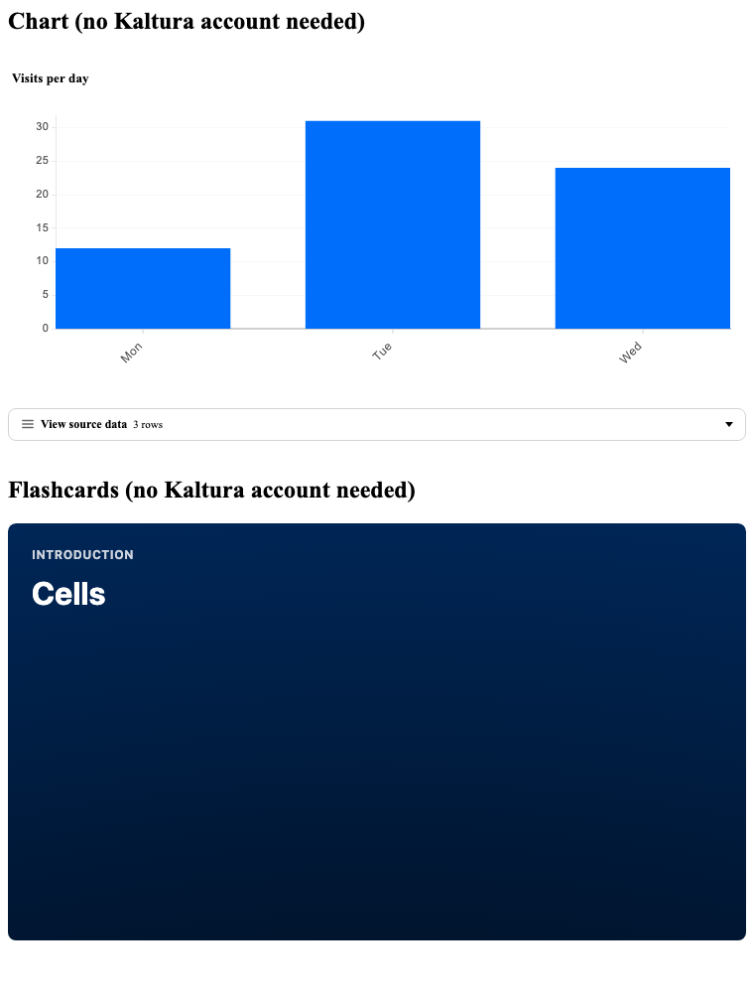
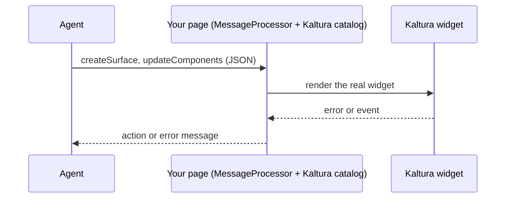

# @kaltura/a2ui-react

Let your AI agent show a Kaltura video player, chart, recorder or flashcards in a chat UI.  
The agent sends JSON, your page renders the real widget.

[A2UI](https://a2ui.org) is the open protocol that lets an agent describe a UI as JSON. This package is the Kaltura catalog for it.

[](https://github.com/kaltura/kaltura-a2ui-components/actions/workflows/ci.yml)
[](https://github.com/kaltura/kaltura-a2ui-components/actions/workflows/e2e.yml)
[](LICENSE)



## How it works



An A2UI client renders only components it has registered ahead of time. There is no runtime code loading. So a Kaltura Player renders only in a client that has this catalog built in.

### Words you will see

| Word | Meaning |
|---|---|
| A2UI | The protocol: an agent sends UI as JSON messages |
| Catalog | The list of components a client can render. This package is the Kaltura catalog |
| Surface | One area of the page that the agent draws into. It has a `surfaceId` |
| KS | Kaltura Session: the token that authorises Kaltura calls. Your server mints it |
| uiConf | The ID of a player or recorder configuration. The customer admin sets it up in KMC |
| Unisphere | The Kaltura framework that loads widgets such as Genie and Media Manager |
| KMC | Kaltura Management Console: where you find your partner, uiConf and entry IDs |

## Quick start

| Choose | If | Install |
|---|---|---|
| [Script tag](#plain-html) | You have a plain HTML page and no A2UI client | None |
| [React or A2UI client](#react-or-a2ui-client) | Your agent drives the page, for example a chat UI | `npm i` |
| [Catalog JSON](#catalog-json) | Your tool reads a catalog by URL | None |

1. Render the widgets (pick a row).
2. [Connect your agent](docs/agent-guide.md).
3. [Set the host rules](#for-the-host).

Most widgets need a Kaltura partner ID, and many need a KS. The chart, and flashcards without video clips, need neither ([which widgets](#components)).

Some chat apps cannot register a catalog, so they cannot show these widgets. Check which catalogs the client supports ([capability negotiation](docs/host-api.md#capability-negotiation)) and reply in plain text when it supports none of yours.

### Install

For the React or A2UI path only. There is no npm package: a package on npm with this name is not ours. Install from the git tag. The tag holds the built `dist/`, so nothing builds on install.

```bash
npm i github:kaltura/kaltura-a2ui-components#v0.4.1 @a2ui/react @a2ui/web_core zod@3 react react-dom
```

zod 4 is not supported. Add this to your `package.json` too ([why](docs/host-integration.md#dompurify-override)):

```json
{ "overrides": { "dompurify": "^3.4.17" } }
```

Gotchas:

- **ESM only.** There is no `require`. Entries: `@kaltura/a2ui-react`, `@kaltura/a2ui-react/webcomponent` (script bundle) and `@kaltura/a2ui-react/catalog` (the catalog JSON).
- **Server-side rendering.** In Node, import `@kaltura/a2ui-react` before `@a2ui/react` ([why](docs/host-integration.md#server-imports-ssr)).
- **One pre-bundled file.** There is no tree-shaking: all 12 components load.
- **Pin the full tag**, such as `v0.4.1`. `@latest` changes under you. Add the `integrity` value from the [Release notes](https://github.com/kaltura/kaltura-a2ui-components/releases). Check a release: [SECURITY.md](SECURITY.md#releases).
- **Peers:** `@a2ui/react ^0.13.0`, `@a2ui/web_core ^0.13.0`, `zod ^3.25.76`, `react ^19` and `react-dom ^19`.

### React or A2UI client

<!-- check-examples: expect h4.kaltura-chart-title; text:Cell -->
```tsx
import { KALTURA_CATALOG_ID, kalturaReactCatalog, setErrorHandler, setKsProvider } from '@kaltura/a2ui-react'; // before @a2ui/react
import { createElement } from 'react';
import { createRoot } from 'react-dom/client';
import { A2uiSurface, type ReactCatalogComponent } from '@a2ui/react/v0_9';
import { MessageProcessor, type A2uiMessage } from '@a2ui/web_core/v0_9';

// Your server mints the KS. Agent messages never carry it.
// `scope` names the data this one widget uses. Your server checks it and grants only that.
setKsProvider(async (widget, { version, scope }) => {
  const res = await fetch('https://your-server.example.com/kaltura-session', {
    method: 'POST',
    headers: { 'content-type': 'application/json' },
    body: JSON.stringify({ widget, version, scope }),
  });
  return res.ok ? res.text() : undefined;
});
setErrorHandler((error) => console.warn('kaltura widget error:', error.code));

// Normally these messages arrive from your agent.
const messages: A2uiMessage[] = [
  { version: 'v0.9', createSurface: { surfaceId: 's', catalogId: KALTURA_CATALOG_ID } },
  {
    version: 'v0.9',
    updateComponents: {
      surfaceId: 's',
      components: [
        { id: 'root', component: 'Column', children: ['chart', 'cards'] },
        { id: 'chart', component: 'KalturaChart', chartType: 'bar', title: 'Visits', data: [{ day: 'Mon', visits: 12 }], xKey: 'day', yKeys: ['visits'] },
        { id: 'cards', component: 'KalturaFlashcards', title: 'Cells', cards: [{ title: 'Cell', content: 'The basic unit of life.' }] },
      ],
    },
  },
];

// The Kaltura catalog already holds the basic components. Register it alone.
// The second argument gets the actions your components send back to the agent.
// The type argument lets A2uiSurface take the surface without a cast.
const processor = new MessageProcessor<ReactCatalogComponent>([kalturaReactCatalog], (action) => console.log('send to agent:', action.name));
processor.processMessages(messages);

// #root is <div id="root"></div> in your page.
const surface = processor.model.getSurface('s');
if (surface) createRoot(document.getElementById('root')!).render(createElement(A2uiSurface, { surface }));
```

Your server mints the KS ([docs/ks-privileges.md](docs/ks-privileges.md)). A working server-side check: [examples/ks-server/privileges.ts](examples/ks-server/privileges.ts). Chart needs no KS, and Flashcards need one only for protected clips.

- The catalog id `https://kaltura.github.io/a2ui/v2/catalog.json` is a name, and the file is also served there (copy of the release asset). Pin the one from [Catalog JSON](#catalog-json). The `v1` id was the 0.3.x catalog: [docs/migration-0.4.md](docs/migration-0.4.md#catalog-v2).
- Send `processor.getRendererCapabilities({ versions: ['v0.9'] })` to your agent as `a2uiClientCapabilities`, so it picks a catalog you registered.
- `buildKalturaCatalog(id?)` builds the same catalog under another id. `loadKalturaCatalog(url)` fetches a catalog JSON and keys it by its `catalogId`.

A full page: [examples/react](examples/react). Next, [connect your agent](docs/agent-guide.md).

### Plain HTML

Custom elements are for pages without an A2UI client. For agent-driven pages use the React catalog.

<!-- check-examples: expect kaltura-chart h4.kaltura-chart-title; text:Cell -->
```html
<script src="https://cdn.jsdelivr.net/gh/kaltura/kaltura-a2ui-components@v0.4.1/dist/kaltura-wc.js" crossorigin="anonymous"></script>

<kaltura-chart id="chart"></kaltura-chart>
<kaltura-flashcards id="cards"></kaltura-flashcards>

<script>
  // The script defines all 12 elements and the global KalturaA2UIWebComponents.
  // Set `config` (an object) on each element.
  document.getElementById('chart').config = {
    chartType: 'bar',
    title: 'Visits',
    data: [{ day: 'Mon', visits: 12 }, { day: 'Tue', visits: 31 }],
    xKey: 'day',
    yKeys: ['visits'],
  };
  document.getElementById('cards').config = { title: 'Cells', cards: [{ title: 'Cell', content: 'The basic unit of life.' }] };
</script>
```

#### Play a Kaltura video

Replace the three `YOUR_` values. Ids are numbers, not strings. Public entries need no KS. For a protected entry, set a KS provider first ([docs/host-integration.md](docs/host-integration.md#kaltura-session-ks)). Find the ids in KMC: partner ID under Settings > Integration Settings, uiConf ID under Studio > Player, entry ID under Content > Entries.

This block needs a real Kaltura account, so `check:examples` skips it.

<!-- check-examples: skip -->
```html
<script src="https://cdn.jsdelivr.net/gh/kaltura/kaltura-a2ui-components@v0.4.1/dist/kaltura-wc.js" crossorigin="anonymous"></script>

<kaltura-player id="player"></kaltura-player>

<script>
  document.getElementById('player').config = { partnerId: YOUR_PARTNER_ID, uiconfId: YOUR_UICONF_ID, entryId: 'YOUR_ENTRY_ID' };
</script>
```

See it run, from a clone of this repo: `npm run example:html` ([examples/README.md](examples/README.md)). A full page with a KS provider and an error handler: [examples/plain-html](examples/plain-html).

### Catalog JSON

For A2UI tooling that reads a catalog by URL:

```
https://cdn.jsdelivr.net/gh/kaltura/kaltura-a2ui-components@v0.4.1/src/catalog/kaltura_catalog.json
```

## Components

| Component | What it shows | Needs a KS? | Custom element |
|---|---|---|---|
| `KalturaPlayer` | A video player for one entry or one manual playlist | Only for protected entries | `<kaltura-player>` |
| `KalturaFlashcards` | Study cards, each with optional video clips | Only for protected clips | `<kaltura-flashcards>` |
| `KalturaChart` | One of 12 chart types | No | `<kaltura-chart>` |
| `KalturaRecorder` | Record webcam or screen and upload | Yes | `<kaltura-recorder>` |
| `KalturaMediaManager` | A library to browse and pick entries | Yes | `<kaltura-media-manager>` |
| `KalturaAnalytics` | The Kaltura analytics dashboard | Yes, an admin KS | `<kaltura-analytics>` |
| `KalturaCaptionsEditor` | An editor for the captions of one entry | Yes | `<kaltura-captions-editor>` |
| `KalturaAvatar` | A live AI avatar you talk to | Yes | `<kaltura-avatar>` |
| `KalturaGenie` | AI search and Q&A over your content | Yes | `<kaltura-genie-widget>` |
| `KalturaContentLab` | AI content creation for an entry | Yes | `<kaltura-content-lab>` |
| `KalturaAgentsWidget` | Kaltura AI agents | Yes | `<kaltura-agents-widget>` |
| `KalturaVodAvatar` | The avatar video studio | Yes | `<kaltura-vod-avatar-wc>` |

Props and payloads for each: [docs/components.md](docs/components.md).

## For the host

The host is the page that embeds the components. Agent output is untrusted: the host owns these settings and the agent cannot change them ([SECURITY.md](SECURITY.md#trust-model)).

| Rule | What you do |
|---|---|
| Supply the KS yourself | Call `setKsProvider(widget => ks)`. It gets the widget name and the scope of that instance (`(widget, request)`), so you can return a least-privilege KS per widget and entry. [docs/security/ks.md](docs/security/ks.md) |
| Limit the accounts | Call `setAllowedPartners` and `setAllowedUiconfs` with your own ids. Default: any id. [docs/host-api.md](docs/host-api.md#allowed-partners-and-uiconfs) |
| Name your private cloud | Call `setExtraAllowedOrigins` for a private or on-prem Unisphere. [docs/host-integration.md](docs/host-integration.md#unisphere-origins) |
| Watch errors and events | Call `setErrorHandler` and `setEventHandler`, or send them to the agent. [docs/host-api.md](docs/host-api.md#agent-feedback) |
| Set a CSP | Allow only the Kaltura hosts you use. [docs/host-integration.md](docs/host-integration.md#content-security-policy) |

More: [docs/host-integration.md](docs/host-integration.md) and [docs/host-api.md](docs/host-api.md). Something broken? [docs/troubleshooting.md](docs/troubleshooting.md).

| Need | Start here |
|---|---|
| Upgrading | [docs/README.md#upgrade](docs/README.md#upgrade) |
| All docs | [docs/README.md](docs/README.md) |
| Develop or contribute | [CONTRIBUTING.md](CONTRIBUTING.md) |

## License

Apache-2.0. See [LICENSE](LICENSE). Releases up to v0.4.0 are AGPL-3.0-only.
