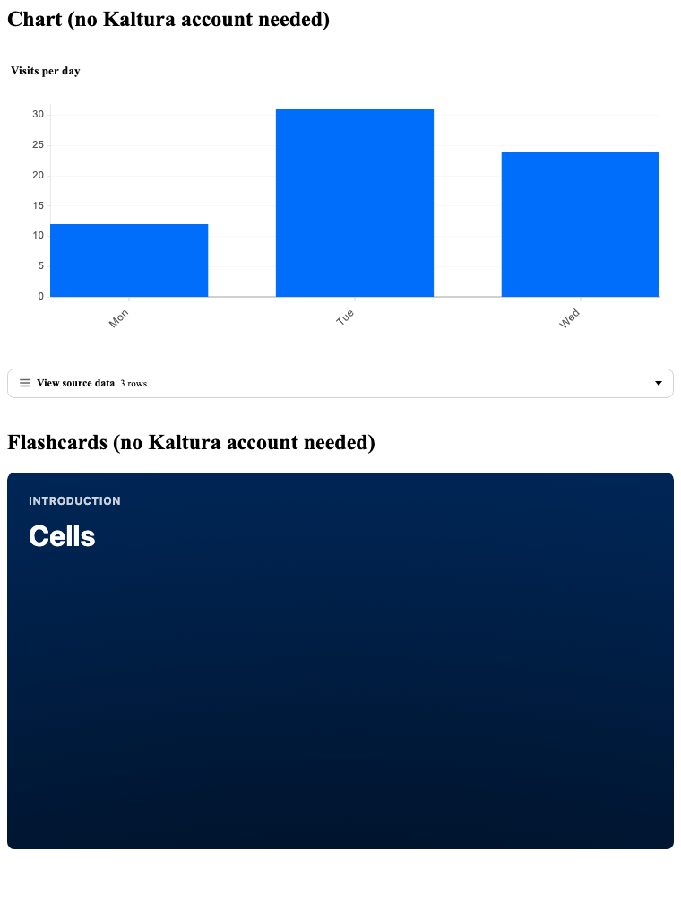

# Examples

Run an example from a clone of this repo. `dist/` is not on `main`, so each command builds first. It needs Node 22.12 or newer and `npm ci`.

| Example | What it shows | Command | Needs a Kaltura account |
|---|---|---|---|
| [plain-html](plain-html/index.html) | One `<script>`, three custom elements, a `kaltura-action` listener and an agent log | `npm run example:html` | No. The Player section fails on purpose without real ids |
| [demo](demo/main.tsx) | The live demo: 12 recorded A2UI 1.0 conversations from [`a2ui/`](a2ui) that cover every Kaltura component, with the wire, the data model and light and dark themes | `npm run demo` | No. Widgets that need Kaltura show their error state |
| [react](react/main.tsx) | A stub agent round trip with `MessageProcessor`: capabilities out, messages in, errors and actions back | `npm run example:react` | No. The Player is refused on purpose by the partner allowlist |

## Sample messages

[`a2ui/*.json`](a2ui) holds 12 conversations. Together they use every Kaltura component, and they include the form and safe-by-default cases. Each file is valid A2UI 1.0. `test/conformance/examples.test.tsx` checks that every file validates and loads, that files without a Kaltura account render, and that every component has an example. The demo plays them.

## What to look for

- The Chart and Flashcards render with no account.
- The agent log at the bottom of the page shows what your agent would receive: the capabilities, a client `error` message and a `playerFeedback` action.
- In the React example, StrictMode runs effects twice in development, so each error shows up twice.

## Copy it into your app

Both examples use only the public API. Replace the stub agent with your own, and replace the allowlist ids with yours. See [Host API](../docs/host-api.md) and [Host integration](../docs/host-integration.md).

`npm run screenshot:examples` rebuilds the image above. It plays a public entry, so it needs network and the variables `SCREENSHOT_PARTNER_ID`, `SCREENSHOT_UICONF_ID` and `SCREENSHOT_ENTRY_ID` (see the script header).
